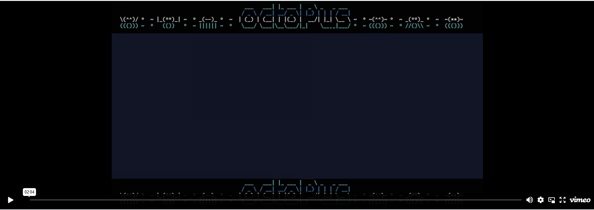
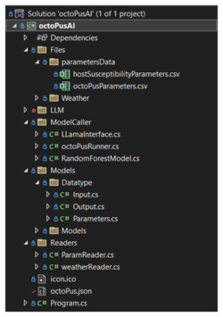
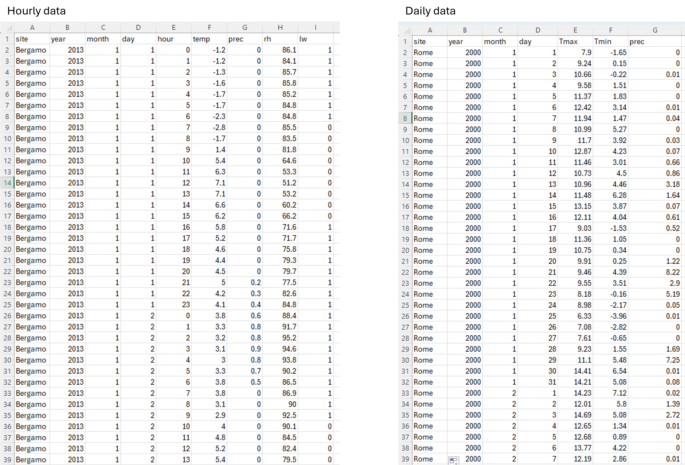
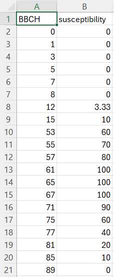
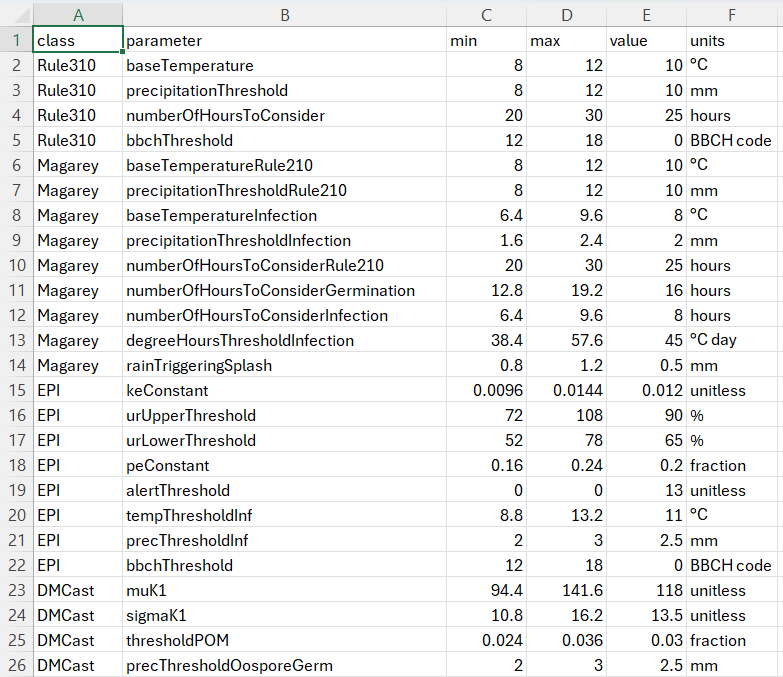
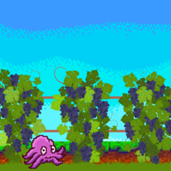

<div style="text-align: center;">
<pre>
                                                   _        ____
                                         ___   ___| |_ ___ |  _ \ _   _ ___
                                        / _ \ / __| __/ _ \| |_) | | | / __|
\(^^)/ °  ~ |_(°°)_| ~  ° _(--)_ °  ~  | (_) | (__| | |(_) |  __/| |_| \__ \ ~  ° ~(^^)~ °  ~ _(°°)_ °  ~  ~(**)~
((())) ~  °   (())   °  ~ |||||| ~  °   \___/ \___|\__\___/|_|    \__,_|___/ °  ~ ((())) ~  ° //()\\ ~  °  ((()))
</pre>
</div>

[](https://vimeo.com/984158457)

> **Latest update: v1.1 (November 2026)** – bug fixes in the infection models, calibrated parameters and a new ensemble output file. See the [Changelog](#changelog) for details.

## The octoPus
The *octoPus* is the first digital organism, released as a console application, that assists users in predicting and interpreting grapevine downy mildew (*Plasmopara viticola*) primary infections. The source code of the *octoPus* is written in C# and is freely available for use through proper citation and licensing. This git repository contains the code and the instructions to smoothly run it.
The *octoPus* has two eyes, the grapevine phenology and susceptibility models, eight tentacles, representing eight *P. viticola* primary infection models, a brain, which is a Random Forest (RF) model, and a voice, a Large Language Model (LLM) that interprets the results of all the other organs and returns an user-supportive textual message. 

## Folder structure


The console application is structured in multiple folders, each containing either input files or classes and processes serving specific purposes. 
- The **Files** folder contains the input files that are needed to run the model: weather data and the parameter files.
	- The weather file(s) should be named like the following "*name-of-location.csv*" and can be either a daily or hourly weather series. Five example files are provided (see [Climate data](#climate-data)).
	- The first parameter file (hostSusceptibilityParameters.csv) is used to codify the BBCH phases of grapevine.
	- The second parameter file (octoPusParameters_optimized.csv) is needed to parameterize the eight primary infection models and the phenology model. It contains the calibrated parameters and is used by default. The original parameter file (octoPusParameters.csv) is kept for reference.
- The **LLM** folder contains the LLama LLM file and will have to be created by the user after cloning the repository.
- The **ModelCaller** folder contains the call to Llama, the pre-trained RF model, and the code to iterate through the weather data.
- **Models** stores the Datatype classes and the calls to the eight epidemiology and the phenology models (in the Models folder).
- **Readers** stores the pipelines to read the parametes, the .JSON configuration file, the console icon, and the entry point main method (Program.cs).
- The **outputs** folder is created automatically at the first run, next to the executable (src/bin/Debug/net8.0/outputs). See [Outputs](#outputs).
- The **dev** folder (in the root of the repository) contains internal development code used for model calibration. It is **not** needed to run the *octoPus* and can be ignored by users.

This document will guide users through the steps needed to successfully run *octoPus* on their machines. First, the [Required packages and extensions](#required-packages-and-extensions) needed to run the console app will be expained in detail. Then, the inputs required and their structure will be analysed together with the user customizations in [Inputs and customization](#inputs-and-customization). Finally, the files produced by the *octoPus* are described in [Outputs](#outputs).
This Git repository is a supplement to the scientific article "Releasing the *octoPus*, an open-source digital tool to promote Integrated Pest Management" (Smart Agricultural Technology 11 (2025) 101015, DOI: [https://doi.org/10.1016/j.atech.2025.101015](https://doi.org/10.1016/j.atech.2025.101015)), in which the *octoPus* is introduced, calibrated, and tested in Italy. Another publication on SoftwareX "*octoPus*: an open-source software for supporting farmers in the control of grapevine downy mildew" (DOI: [https://doi.org/10.1016/j.softx.2025.102085](https://doi.org/10.1016/j.softx.2025.102085)) delves into the technical details of the console application. 

## Required packages and extensions
The *octoPus* works on Windows, Linux, and macOS operating systems and requires a series of programs, packages, and extensions to run.
* .NET ≥ 8.0  
Please visit [this link](https://learn.microsoft.com/en-us/dotnet/core/install/upgrade) to download or update .NET.
* R version ≥ R-4.3.2 (only needed if the Random Forest is used, see "useRandomForest" in the [JSON configuration file](#json-configuration-file))  
Please download the R version compatible to your operating system ([windows](https://cran.r-project.org/bin/windows/base/), [macOS](https://cloud.r-project.org/bin/macosx/), or [Linux](https://cran.r-project.org/)).
* Llama Large Language Model ≥ Meta-Llama-3 (only needed if the LLM is used, see "useLLM")  
Please visit [this link](https://huggingface.co/models?other=llama) to download the latest Llama version from [huggingface.co](https://huggingface.co/) or at [this link](https://llama.meta.com/llama-downloads) from the [Meta](https://ai.meta.com/meta-ai/) website. Once downloaded, create a folder called LLM as shown in [Folder structure](#folder-structure) and store the downloaded file in it.

The following dependencies and packages are used. The *octoPus* includes code lines to automatically download them if not pre isntalled in the system. Visit the links to find more information on each dependency or package used.
* .NET libraries:
  * LLamaSharp ([LINK](https://github.com/SciSharp/LLamaSharp.git) to documentation)
  * MathNet.Numerics ([LINK](https://numerics.mathdotnet.com/) to documentation)
  * R.NET ([LINK](https://rdotnet.github.io/rdotnet/) to documentation)
* R packages:
  * caret ([LINK](https://cran.r-project.org/web/packages/caret/index.html) to documentation)
  * randomForest ([LINK](https://cran.r-project.org/web/packages/randomForest/index.html) to documentation)
  * stats ([LINK](https://cran.r-project.org/web/packages/STAT/index.html) to documentation)

## Inputs and customization

### Climate data
The *octoPus* needs to be fed with weather series in .csv format to run. Weather data are stored by default in "src/Files/Weather", in the subfolder "hourly" or "daily" according to their time step. It requires hourly or daily data for temperature (°C), precipitation (mm), relative humidity (%), and leaf wetness (%). An example of a hourly weather series for the Italian city of Bergamo is provided below. If daily data are used, hourly series are estimated from daily maximum and minimum temperatures.



Column [ 0 , 1 , 2 , 3 ] are fixed in both the daily and hourly datasets and represent the site, year, month, and day. In the hourly dataset the hour is in column [ 4 ], and columns [ 5 , 6 , 7 , 8 ] are respectively the hourly temperature (°C), precipitation (mm), radiation, relative humidity (%), and leaf wetness (0-1). The daily datset only needs maximum [ 4 ] and minimum [ 5 ] temperatures (°C), and daily precipitation (mm) [ 6 ]. All other variables are estimated from these three. Multiple weather files, with the same temporal resolution, can be used to perform simultaneous analysis on different locations by uploading them in the dedicated folder ("src/Files/Weather/hourly" or "src/Files/Weather/daily") but some steps are required in the [JSON configuration file](#json-configuration-file).

The repository provides five example weather files:
- hourly: example_Bergamo.csv, example_Treviso.csv, example_Perugia.csv, example_Oristano.csv
- daily: example_rome.csv

**Spin-up year.** The dormancy model needs the chilling accumulated in the autumn before the first season. The first simulated year should therefore be considered a spin-up year: in that year the phenology may not start and its results should be discarded. Weather data should start at least one autumn before the first season of interest.

Once the climate data are ready, attention should be given to the host susceptibility parameterization.

### Host susceptibilty data
Host susceptibility data are stored by default in "src/Files/Parameters/hostSusceptibilityParameters.csv". This .csv file is composed of two columns: BBCH [ 0 ] and susceptibility [ 1 ]. 



The file classifies the susceptibility of crucial grapevine BBCH phases (from budbreak, BBCH 11, to maturity, BBCH 89) in column [ 0 ] by assigning to them a score (column [ 1 ]) through a linear interpolation of expert-based opinions obtained from a survey circulated among Italian extension services (see [Bregaglio et al., 2022](https://doi.org/10.1016/j.jenvman.2022.115365)). BBCH phases and their susceptibility scores can be modified by the users. This done, the models can be parameterized according to specific use cases.

### Models parameterization
The models configuration is stored by default in "src/Files/Parameters/octoPusParameters_optimized.csv" (calibrated parameters). In this .csv file the parameters specific to each of the ten models (the eight primary infection models, the phenological model, and the susceptibility model) can be modified. The class column [ 0 ] contains the name of the model and column [ 1 ] is the specific parameter. These two columns **should not be modified**. Columns [ 2 , 3 , 4 ] represent respectively the minimum and the maximum values, and the actual value to be used in the simulation. Column [ 5 ] is the measurement unit of each specific parameter. 



Two groups of parameters are shared by all the infection models:
- **bbchThreshold** (one for each model, default BBCH 11): the infection models simulate infections only when the simulated grapevine phenology has reached this BBCH stage.
- **Incubation** parameters: after each infection, an incubation module computes the hourly progress of the latent period as a function of temperature and returns the date of symptom onset.

For an exaustive description of each model routine and their parameters we refer to the Supplementary material S1 of Bregaglio et al., 2025.

### JSON configuration file
The JSON file can be found in "src/octoPus.json" and it allows to fine-tune additional settings of the *octoPus*. At each build, the file is copied next to the executable (src/bin/Debug/net8.0/octoPus.json), which is the copy read by the program. The JSON file is divided in three classes: one used to define model settings, one to explicit filepaths, and one to personalize the console colors. Below is reported the structure of the JSON file with example values and a brief explanation of each attribute.

<pre><code class = "language-json">
{
    "settings": {
        "startYear": 2010,
        "endYear": 2025,
        "sites": [ "example_Bergamo.csv", "example_Treviso.csv", "example_Perugia.csv", "example_Oristano.csv" ],
        "assistantRisk": 3,
        "veryHighModelsThreshold": 6,
        "WeatherTimeStep": "hourly",
        "colorScale": "Viridis",
        "consoleTextColor": "Magenta",
        "consoleBackgroundColor": "Blue",
        "useLLM": false,
        "useRandomForest": false,
        "useConsole": false
    },
    "paths": {
        "weatherDir": "..\\..\\..\\files\\Weather\\",
        "octoPusParametersPath": "..\\..\\..\\files\\Parameters\\octoPusParameters_optimized.csv",
        "susceptibilityFileBBCH": "..\\..\\..\\files\\Parameters\\hostSusceptibilityParameters.csv",
        "outputDir": "..\\..\\..\\outputs\\",
        "LLMfile": "..\\.\\..\\..\\LLM\\Meta-Llama-3-8B-Instruct-correct-pre-tokenizer-and-EOS-token-Q8_0.gguf",
        "Rversion": "R-4.4.2"
    },
    "colorScales": {
        "Viridis": [ "DarkMagenta", "DarkBlue", "Cyan", "Green", "Yellow" ],
        "Cividis": [ "DarkBlue", "Blue", "Gray", "Yellow", "DarkYellow" ],
        "Magma": [ "Black", "DarkMagenta", "Magenta", "Red", "Yellow" ],
        "Plasma": [ "DarkMagenta", "Magenta", "Red", "DarkYellow", "Yellow" ],
        "Turbo": [ "DarkMagenta", "Blue", "Green", "Yellow", "Red" ],
        "Grayscale": [ "White", "Gray", "DarkGray", "Black", "Black" ],
        "Traditional": [ "Green", "Yellow", "DarkYellow", "Red", "DarkRed" ],
        "ColorblindFriendly": [ "Blue", "Cyan", "Gray", "Yellow", "White" ],
        "Heatmap": [ "Black", "DarkRed", "Red", "Yellow", "White" ],
        "Cool": [ "DarkBlue", "Blue", "Cyan", "Green", "White" ]
    }
}

</code></pre>

Inside the *settings* class, the "startYear" and "endYear" of the simulation should be inserted as int (remember that the first year is a spin-up year, see [Climate data](#climate-data)). The "sites" is a list that contains the filenames of the weather data files for which the model should run (**only** the files written in the square brackets, separated by a comma, will be used as input weather data and for each of them an output file will be produced). "assistantRisk" (is an int from 0 to 5, corresponding to very low, low, medium, high, and very high) defines the daily level of risk at which the LLM assistant is called in the routine. "veryHighModelsThreshold" (an int from 0 to 8, default 6) is the number of infection models that must simulate an infection on the same day to classify that day as a very high risk day, whatever the risk predicted by the Random Forest. The "WeatherTimeStep" property accepts strings that are either "daily" or "hourly" and should match the format of the weather data used. "colorScale" allows users to personalize the colors of the five risk classes selecting from a list of pre-defined color combinations, "consoleTextColor" changes the color of the printed console text, and "consoleBackgroundColor" modifies the background color of the console. The "useLLM" (bool) property Determines whether the LLM is used in the simulation. If false, the assistant will not be involved in decision-making or risk evaluation. The "useRandomForest" (bool, default false) property indicates whether the Random Forest model is used for predictions. If true, the daily infection risk is computed and the [ensemble output](#ensemble-output) is written; R must be installed. If false, the simulation will not use Random Forest-based predictions for risk assessment and only the [infection models output](#infection-models-output) is written. The 'useConsole' (bool) property controls whether console output is enabled. If false, the program will suppress console logs, preventing textual outputs from appearing in the terminal.

The *paths* class explicitly defines the paths of input and output files. Noticeable are the two properties "LLMfile" and "Rversion". The first one defines the location and the name of the LLM file, which is **not** provided in this repository therefore should be created by the user before running the app (see section [Required packages and extensions](#required-packages-and-extensions) for the instructions on how to download Llama). "Rversion" is a string that specifies the R version currently installed on the machine and it is required to run the RF model.
Paths are relative to the executable and use the Windows separator ("\\"). On Linux and macOS, paths should use "/" and match the exact case of the folder names (e.g., "Files" instead of "files").

Finally, the *colorScales* class contains the ten default color scales that can be selected through the "colorScale" property. Among these, the "ColorblindFriendly" property contains an accessible color scale for color-blind people, but users can modify them or add new ones according to likings/needs. To add a new color scale, a new property should be created inside the *colorScales* class separating it with a comma from the already existing ones, followed by a colon (:) and a list of five colors wrapped in squared brackets and separated by commas (e.g., "personalized1" : ["blue", "green", "yellow", "orange", "red"]).

### Launching the *octoPus*
After having completed this last step, the model is ready to be run with the specified user settings. Launch it and enjoy the *octoPus* at work!!

## Outputs
Output files are written in the "outputs" folder next to the executable (src/bin/Debug/net8.0/outputs). The folders are created automatically at the first run. One file is written for each site, with the same name as the weather file.

### Infection models output
Folder: "outputs/diseaseModels". One row per day, with the following columns:

| Group | Columns | Description |
|---|---|---|
| Site and date | site, Date | weather file and day |
| Weather | Tmax, Tmin, Prec, LW, RHmax, RHmin | daily maximum and minimum temperature (°C), precipitation (mm), leaf wetness duration (hours), maximum and minimum relative humidity (%) |
| Phenology | chillState, ChillRate, antiChillState, forcingRate, forcingState, cycleCompletion, bbchCode, bbchPhase, plantSusceptibility | dormancy and forcing states, simulated BBCH stage and host susceptibility |
| Infections | Rule310, Epi, Ipi, Dmcast, Magarey, UCSC, misfits, laore | 1 if the model simulates an infection on that day, 0 otherwise |
| Onsets | onsRule310, onsEpi, onsIpi, onsDmcast, onsMagarey, onsUCSC, onsmisfits, onslaore | 1 if the symptoms of a previous infection appear on that day (end of the incubation), 0 otherwise |
| Pressure | pressureRule310 ... pressureLaore | cumulated number of infections in the season for each model (counted from BBCH 11) |

### Ensemble output
Folder: "outputs/ensemble". Written only if "useRandomForest" is true. One row per day, with the following columns:

| Group | Columns | Description |
|---|---|---|
| Site and date | site, Date, year, doy | site name, date (yyyy-MM-dd), year and day of year |
| Weather | Tmax, Tmin, Tmean, Prec, LW, RHmax, RHmin, RHmean | daily temperatures (°C), precipitation (mm), leaf wetness duration (hours), relative humidity (%) |
| Phenology | bbchCode, plantSusceptibility | simulated BBCH stage and host susceptibility |
| Infections | Rule310, Epi, Ipi, Dmcast, Magarey, UCSC, misfits, laore | 1 if the model simulates an infection on that day, 0 otherwise |
| Pressure | pressureRule310 ... pressureLaore | cumulated number of infections in the season for each model |
| Risk | nModelsInfection | number of models simulating an infection on that day (0-8) |
| | riskRF | daily infection risk predicted by the Random Forest (1 = very low, 5 = very high) |
| | riskLabelRF | risk class predicted by the Random Forest (VERY LOW, LOW, MEDIUM, HIGH, VERY HIGH) |
| | riskLabelAdjusted | risk class after the "veryHighModelsThreshold" rule: VERY HIGH when nModelsInfection ≥ veryHighModelsThreshold, otherwise equal to riskLabelRF |

The Random Forest is called only inside the epidemic window, from BBCH 11 to 31 August. Outside this window the risk columns are empty. Decimal numbers are always written with the decimal point, whatever the regional settings of the computer.

**Note on the Random Forest risk.** The Random Forest was trained on the outputs of the original model parameterization. With the calibrated parameters, the daily risk tends to remain high after the first infections of the season. A retrained Random Forest will be released in a future version.


```
\(^^)/ °  ~ |_(°°)_| ~  ° _(--)_ °  ~  ~(^^)~ °  ~ _(°°)_ °  ~  ~(**)~ °  ~ \(^^)/ °  ~ |_(°°)_| ~  ° _(--)_ °  ~  ~(^^)~ °  ~ _(°°)_ °  ~  ~(**)~
((())) ~  °   (())   °  ~ |||||| ~  °  ((())) ~  ° //()\\ ~  °  ((())) ~  ° ((())) ~  °   (())   °  ~ |||||| ~  °  ((())) ~  ° //()\\ ~  °  ((()))
```

## Changelog
The version published with Bregaglio et al. (2025) is tagged as [v1.0-published](../../tree/v1.0-published).

### [v1.1] - 2026-11
#### Added
- Incubation module for all the infection models and daily onset (symptom appearance) outputs.
- Ensemble output file ("outputs/ensemble") with the daily infection risk of the Random Forest, the number of models simulating an infection and the adjusted risk class.
- Calibrated parameter file (octoPusParameters_optimized.csv), used by default.
- Five example weather files (example_*.csv).
- Automatic creation of the output folder.

#### Fixed
- Bug fixes in the infection models and in the simulation runner (see the commit history for details).

#### Changed
- .NET 8.0 is required.
- The Random Forest is called only inside the epidemic window (BBCH 11 – 31 August).
- Default settings: "veryHighModelsThreshold" = 6, "useRandomForest" = false; relative path for "weatherDir".

#### Removed
- Obsolete .NET 7.0 build.
- Non-example weather files, calibration data and simulation outputs from the repository.

## License
Attribution-NonCommercial-NoDerivatives 4.0 International

## References
Bregaglio, S., Savian, F., Raparelli, E., Morelli, D., Epifani, R., Pietrangeli, F., Nigro, C., Bugiani, R., Pini, S., Culatti, P., Tognetti, D., Spanna, F.,   Gerardi, M., Delillo, I., Bajocco, S., Fanchini, D., Fila, G., Ginaldi, F., Manici, L.M., 2022. Journal of Environmental Management 317, 115365. https://doi.org/10.1016/j.jenvman.2022.115365 

Bregaglio, S., Rossi, E., Ascari, L., Mongiano, G., Del Cavallo, E., Bajocco, S., Manici, L.M., Pepe, A.G., et al., 2025. Releasing the *octoPus*, an open-source digital tool to promote Integrated Pest Management. Smart Agricultural Technology 11, 101015. https://doi.org/10.1016/j.atech.2025.101015